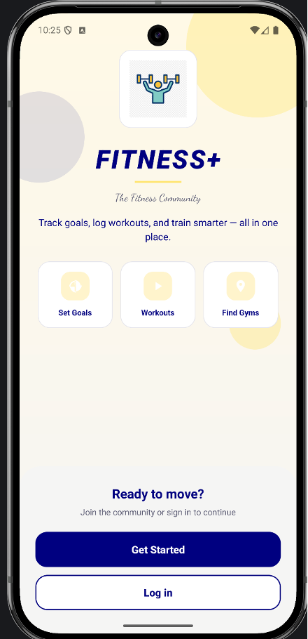
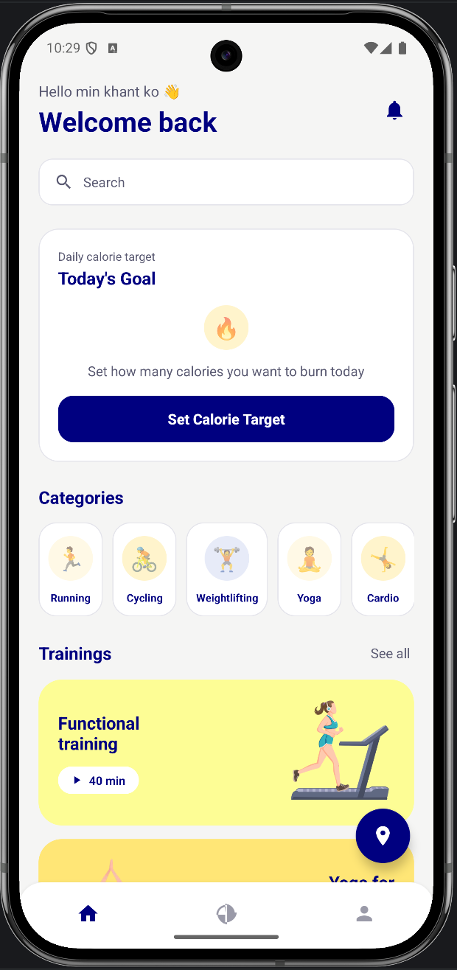
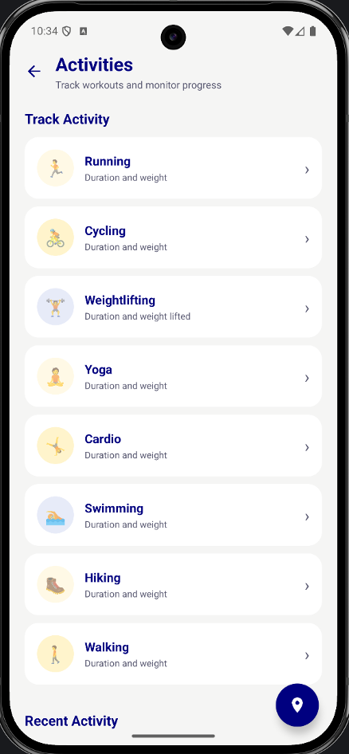
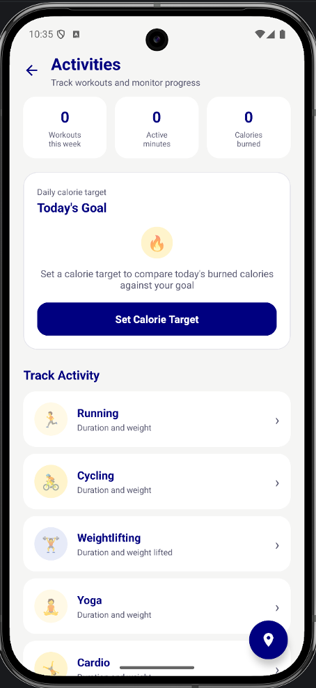
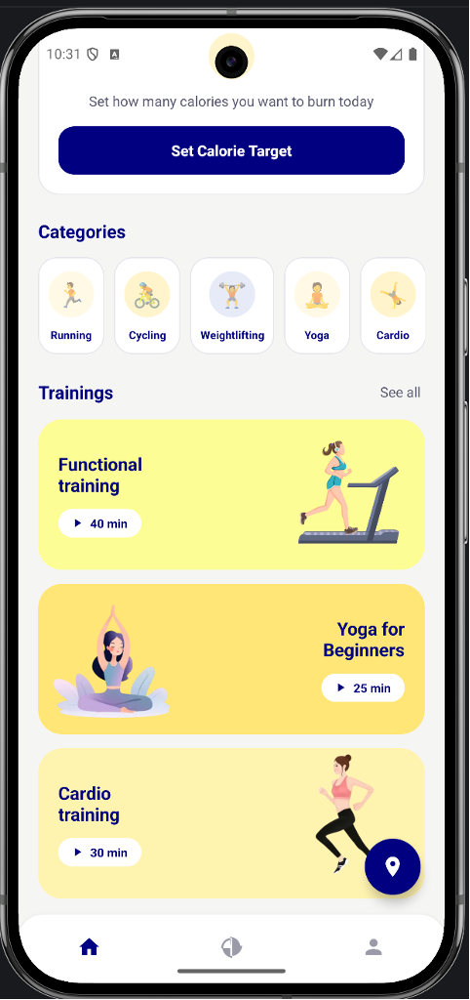

# Fitness+ Android Application

### Android Fitness Tracking App | Academic Project

## About the Project

Fitness+ is an Android fitness tracking application I developed as an academic project. It helps users record physical activities, set fitness goals, and monitor their fitness progress.

Through this project, I gained practical experience in Android development using Kotlin, designing mobile interfaces with XML, and connecting an Android application to a PHP and MySQL backend.

## Technologies Used

- **Kotlin** – Android application development
- **XML** – User interface layouts
- **PHP** – Backend API development
- **MySQL / MariaDB** – Database management
- **Android Studio** – Development environment

## Key Features

- User registration and login
- Physical activity tracking
- Fitness goal setting
- Workout history
- Fitness progress monitoring
- PHP API integration
- Database storage for user information and activities

## Project Screenshots

### Welcome Screen

### Main Screen

### Activity Tracking

### Fitness Goals

### Fitness Videos

## Project Structure

- `register/` – Android Studio application
- `fitness/` – PHP backend
- `Fitness.sql` – Database schema and exercise data

## How to Run

1. Open the `register/` project in Android Studio.
2. Set up a local PHP and MySQL environment.
3. Import `Fitness.sql` into MySQL.
4. Configure the PHP database connection using the required environment variables.
5. Update the Android application's API base URL to point to the PHP server.
6. Run the application using an Android emulator or physical device.

**Note:** The published SQL file excludes personal user records. The backend also includes legacy password verification for compatibility, which should be upgraded before production deployment.

## Project Information

**Developer:** May Myint Myat  
**Project Type:** Academic Project  
**Qualification:** NCC Level 5 Diploma in Computing  
**Institution:** Strategy First College

---

*Developed as part of my academic studies.*
